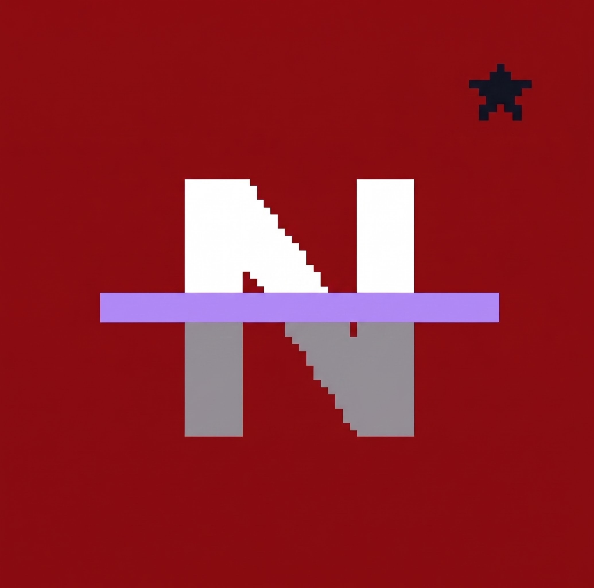

<div align="center">



# Nebula Launcher
### Клиент Minecraft: Java Edition 26.3 для Android на Rust

[](https://github.com/sshremoteh/Nebula-Launcher/releases/tag/v1.1)
[](https://github.com/sshremoteh/Nebula-Launcher)
[](https://github.com/sshremoteh/Nebula-Launcher)
[](https://github.com/sshremoteh/Nebula-Launcher)
[](https://sshremoteh.github.io/Nebula-Launcher/)

<p align="center">
  Нативный клиент Minecraft: Java Edition для Android-устройств.<br>
  Рендеринг на базе Vulkan и OpenGL ES 3.0, сенсорное управление Bedrock Touch, поддержка Java-серверов.
</p>

[**Скачать APK (v1.1 Release)**](https://github.com/sshremoteh/Nebula-Launcher/releases/latest/download/Nebula-Launcher-v1.1.apk) • [**Сайт проекта**](https://sshremoteh.github.io/Nebula-Launcher/) • [**Релизы**](https://github.com/sshremoteh/Nebula-Launcher/releases)

---

</div>

## Возможности

<table>
  <tr>
    <td width="50%">
      <h3>Движок и рендеринг</h3>
      <ul>
        <li>Нативный бинарный код на <b>Rust</b> через <code>wgpu</code> (без JVM-эмуляции в интерфейсе).</li>
        <li>Поддержка графических бэкендов <b>Vulkan</b> и <b>OpenGL ES 3.0</b>.</li>
        <li>Частота кадров до 60–120 FPS в зависимости от чипсета, потребление ОЗУ от 2.5 ГБ.</li>
      </ul>
    </td>
    <td width="50%">
      <h3>Сенсорное управление Bedrock Touch</h3>
      <ul>
        <li>4 схемы ввода: аналоговый джойстик или кнопочный D-Pad.</li>
        <li>Прицеливание касанием по экрану или фиксированным перекрестием.</li>
        <li>Настройка позиций, размеров и прозрачности экранных кнопок.</li>
      </ul>
    </td>
  </tr>
  <tr>
    <td width="50%">
      <h3>Сетевая игра Java Edition</h3>
      <ul>
        <li>Подключение к серверам Minecraft Java (Hypixel, LAN-серверы, локальная сеть).</li>
        <li>Автономный оффлайн-режим для одиночной игры.</li>
        <li>Импорт и экспорт миров через системный Storage Access Framework.</li>
      </ul>
    </td>
    <td width="50%">
      <h3>Лаунчер Nebula 1.0</h3>
      <ul>
        <li>Двухпанельный адаптивный интерфейс для альбомного и портретного режимов.</li>
        <li>Аппаратная отрисовка векторных элементов без растровых артефактов.</li>
        <li>Детальный прогресс-бар: процент каждого этапа, мегабайты и счетчик файлов.</li>
      </ul>
    </td>
  </tr>
</table>

---

## Скриншоты на устройстве

| Джойстик и перекрестие | D-Pad и касание |
| :---: | :---: |
|  |  |

| Заснеженный ландшафт | Hypixel Arcade (Java Multiplayer) |
| :---: | :---: |
|  |  |

| Вид от третьего лица | Пустыня |
| :---: | :---: |
|  |  |

---

## Установка

1. Скачайте файл [**Nebula-Launcher-v1.1.apk**](https://github.com/sshremoteh/Nebula-Launcher/releases/latest/download/Nebula-Launcher-v1.1.apk).
2. Установите APK на устройство (при запросе разрешите установку из используемого источника).
3. Запустите **Nebula Launcher**.
4. Укажите никнейм в левой панели (сохраняется автоматически).
5. Нажмите **«СКАЧАТЬ MINECRAFT 26.3»** для начальной распаковки игровых данных.
6. Нажмите **«И Г Р А Т Ь»** для запуска клиента.

---

## Системные требования

| Параметр | Минимум | Рекомендуется |
| :--- | :--- | :--- |
| **ОС** | Android 9.0 (API 28) | Android 12–15+ (API 31–35) |
| **Архитектура** | 64-bit ARM (`arm64-v8a`) | 64-bit ARM (`arm64-v8a`) |
| **Оперативная память** | 3 ГБ | 6–8 ГБ |
| **Графика** | OpenGL ES 3.0 | Vulkan 1.1+ |
| **Хранилище** | 500 МБ свободного места | 2 ГБ |

---

## Сборка из исходного кода

Сборка выполняется через автономный скрипт [`build.sh`](build.sh):

```bash
git clone https://github.com/sshremoteh/Nebula-Launcher.git
cd Nebula-Launcher

# Проверка синтаксиса и типов
./build.sh check

# Компиляция и сборка подписанного APK (arm64-v8a)
./build.sh apk fast

# Собранный файл:
# .local/android/apk/nebula-launcher.apk
```

---

## Лицензия

* Исходный код проекта распространяется под открытыми лицензиями (MIT / Apache-2.0 / GPL-3.0 в зависимости от компонентов).
* Клиент основан на открытом проекте Horizon (движок Minecraft Java 26.3 на Rust).
* Minecraft является товарным знаком Mojang AB / Microsoft. Проект не связан с Mojang AB.
